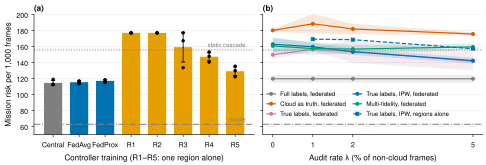

# Route 1: a routing controller for each frame, and federated training of the controller

Branches: `main` history up to `vision-fl` (steps 1 to 4b, plan A, plan F, FC1, FC2). All later branches contain this work.
Read `00_foundations.md` first. This file uses its concepts.

## 1. The idea in simple words

The drone has a fast classifier that is correct on 96% of the frames. For the other 4%, a slower model on the drone (SmolVLM) or a model in the cloud (Qwen) is often correct. A **controller** looks at each frame after the classifier and decides one action:

1. **accept** the classifier answer,
2. **escalate** to SmolVLM on the drone,
3. **escalate** to the cloud model.

A good controller escalates only the frames where the classifier is probably wrong and where the other tool is probably right. It must also respect a deadline and the state of the radio link.

Mechanical analogy: this is a staged inspection. All parts get a visual check. Only the parts with an unclear result go to the ultrasonic test, because the ultrasonic test is slow. The controller is the rule that decides which parts go to the second stage.

## 2. Conceptualisation: why a controller can help

Step 2 measured the tools on the 7,057 test items (`docs/step2_results.md`):

| Tool | Accuracy | Time on GPU | Upload |
|---|---|---|---|
| ResNet-50 classifier | 0.961 | 7.3 ms | 0 |
| SmolVLM-256M with LoRA, on the drone | 0.956 | 80.8 ms | 0 |
| SmolVLM, split (int8 visual tokens sent to the cloud) | 0.957 | 80.2 ms | 36.9 kB |
| Qwen3-VL-8B in the cloud, zero-shot | 0.792 | 126.9 ms | 35.4 kB |

The tools make **different errors**. The classifier makes 279 errors on the test items. SmolVLM is correct on 186 of them, and the cloud on 135. Thus a perfect selection of the tool (the **oracle**) is much better than any single tool. This difference between the oracle and the best single tool is the **headroom** for a controller.

## 3. The replay: a simulated mission

The project has no drone and no Jetson. Thus it uses a **replay** (`docs/step3_results.md`):

- Each tool ran once on every frame. The replay reads these saved answers.
- One frame arrives every 1.16 s, as in EVLM. Each frame has a deadline of 4 s. A late answer is a miss.
- The onboard tools share one queue. Their time is the GPU time multiplied by 9, an estimate of the gap to a Jetson Orin NX.
- The upload follows real LTE traces. The project scales them into three regimes: good, weak (10% bandwidth, six 20 s outages per hour) and poor.
- A cloud request fails when the transfer takes more than 3 s or the link is down.

Mechanical analogy: the replay is a hardware-in-the-loop test without the hardware. The test bench stores the measured component responses, and a simulator replays them under different load profiles.

**Baselines in the weak regime** (risk per 1,000 frames):

| Policy | Risk | Escalated frames |
|---|---|---|
| Oracle (knows the correct tool) | 62.9 | 3.1% |
| Static cascade: SmolVLM if classifier confidence < 0.95 | 155.7 | 14.4% |
| Classifier only | 177.0 | 0% |
| EVLM pipeline: SmolVLM on each frame | 188.3 | 100% |
| Cloud on each frame | 648.5 | 100% |

The oracle escalates only 3.1% of the frames. Thus the task is to **select the correct frames**, not to escalate more frames.

## 4. The math of the controller

### 4.1 Step 4: a correctness target

The first design estimates, for each tool $k$, the probability $q_k$ that the tool is correct on the frame. Then a constant rule calculates an expected cost for each tool:

$$J_k = (1 - q_k)\,c_{\text{wrong}} + \lambda\,t_k, \qquad c_{\text{wrong}} = 10\,P(\text{defect}) + 1\,P(\text{good})$$

The rule rejects tools that cannot meet the deadline, and it selects the tool with the lowest $J_k$. The estimator for $q_k$ is a binary classifier (MLP, logistic regression, or a decision model).

Result: the MLP with this rule gets 136.4, 12% better than the cascade. The rule with the true $q_k$ gets the oracle result. Thus the rule is correct, and the error comes from the estimates.

An important lesson: the AUROC of $q_k$ was almost the same for all estimators (difference 0.01 or less), but their risk was very different. A good ranking of each tool alone does not give a good choice between tools.

### 4.2 Step 4b: a choice target

The second design learns the **choice** directly. For each training frame, the saved answers give the risk $r_a$ of each action $a$. The target is a soft distribution over the actions:

$$y_a = \mathrm{softmax}(-r_a / T)$$

Here $r_a$ includes a small escalation cost (0.1 for SmolVLM, 0.2 for the cloud). The training minimises the soft cross-entropy between the controller output and $y$. This is a **multi-class classification with soft labels**: the classes are the 3 actions.

**Informative frames** are frames where the actions differ in risk by more than the escalation cost. They are rare, so the training uses 5 copies of each informative frame (oversampling).

A constant rule changes the output into a decision. The rule escalates to the best tool if its probability is larger than the probability of "accept" by a margin. It escalates only if the tool can meet the deadline. We tune the margin on the validation towers.

### 4.3 The model

| Part | Value |
|---|---|
| Input | Task type, component type, classifier confidence, top-two margin, entropy, predicted label, class probabilities, image size, blur, brightness, contrast |
| Network | MLP, two hidden layers of 64 units |
| Parameters | 7,171 (28.7 KB in fp32) |
| Output | Probability of accept, SmolVLM, cloud |
| Loss | Soft cross-entropy against $\mathrm{softmax}(-r_a/T)$ |

The network state does not go into the MLP. The deadline rule handles it. Thus this design keeps the federated weights independent of the network of each drone.

**Result of step 4b**: risk 114.2, 27% better than the static cascade. The decision models (nano-jev 33M: 125.3, Laya 421M: 150.0) were worse than the small MLP.

## 5. Plan A and plan F: two side questions

**Plan A, few labels.** How many labelled frames does a controller need? With 1% of the training frames (about 255 frames), no controller learns a useful decision (risk about 172). With 5%, the learned controllers are equal to the cascade. They beat it only with more than about 1,300 to 5,100 labelled frames. One drone does not collect so many labels quickly. This result is the reason for federated learning.

**Plan F, operator intents in free text.** Can a language model read an instruction like "focus on rust" and use it? Without a budget, the intent has almost no value. With a 2% escalation budget, a perfect reader of the intent decreases the risk by 5% to 8%. A decision model cannot show an advantage here.

## 6. Federated training of the controller (FC1 and FC2)

### 6.1 Clients and training

A client is an **operator region**: a group of towers with its own images and labels. The 18 training towers form 5 regions (4,579 to 6,449 frames each). Two regions have only one large tower, so the data is strongly non-IID.

FedAvg trains the MLP. In each round, each region runs 10 full-batch Adam steps (learning rate $10^{-3}$) from the global weights. The server takes the weighted mean. Training stops 30 rounds after the best validation loss.

*Figure: (a) full feedback. (b) one-sided feedback against the audit rate. Mean of 3 seeds, weak network.*

### 6.2 FC1: full feedback

With labels for every frame:

| Controller | Risk | Upload |
|---|---|---|
| Central training (all images in one place) | 114.6 ± 3.1 | images pooled |
| FedAvg over 5 regions | 115.4 ± 1.6 | 6.7 to 7.9 MB in total |
| FedProx | 117.1 ± 1.6 | 7.0 to 8.3 MB |
| Each region alone (mean) | 157.9 ± 20.4 | 0 |
| Static cascade | 155.7 | 0 |

FedAvg is equal to central training. Regions alone are not better than the cascade. The two single-tower regions never learn to escalate. What a region lacks is variety, not volume.

### 6.3 FC2: one-sided feedback

In a real deployment, the controller does not see the true label of most frames:

| Action | What the learner sees |
|---|---|
| Accept | Nothing. With probability $\lambda$, an **audit** sends the frame to the operator. |
| SmolVLM | The SmolVLM answer, not a label. Audit as for accept. |
| Cloud | The cloud answer (noisy, accuracy 0.79). With probability 0.5, the operator reviews it. |

The controller's own choices decide which of its errors it can see. This is **policy-dependent feedback**, a type of bandit problem.

We compared five learners:

| Learner | What it uses |
|---|---|
| Full labels | All true labels (upper bound) |
| Cloud as truth | The cloud answer as the label |
| True labels | Operator labels only |
| True labels, IPW | Operator labels, each weighted by $1/P(\text{label seen})$ |
| Multi-fidelity | Cloud answers corrected with a confusion matrix from frames that have both |

**IPW** (inverse propensity weighting) corrects a bias. The controller sees the labels of the frames it escalates more often. A weight $1/P$ gives the rare labels more importance, so the sample represents all frames again. We clip the weight at $1/0.02$ to keep the variance small.

Results with federated learning (weak network, 3 seeds):

| Learner | Risk | Operator labels | Upload of frames |
|---|---|---|---|
| Full labels | 119.7 ± 4.8 | 25,499 | — |
| Cloud as truth, 5% audit | 175.7 ± 2.1 | 2,443 | 141 MB |
| True labels, no audit | 149.6 ± 5.4 | 386 | 30 MB |
| True labels, IPW, 5% audit | 142.4 ± 3.6 | 1,727 | 76 MB |
| Multi-fidelity, 2% audit | 156.8 ± 5.3 | 1,052 | 58 MB |
| Regions alone, IPW, 5% audit | 157.3 ± 5.3 | 2,047 | 101 MB |

Main lessons:

1. **Cloud answers are bad teachers.** The cloud is wrong on 1,322 test items where the classifier is right. The controller then learns to distrust correct onboard answers.
2. **A 5% audit is necessary.** Without it, the fleet collects only about 386 true labels, which is below the threshold of plan A.
3. **Federation is necessary.** Regions alone with the same audit do not beat the cascade.
4. **Labels cost more upload than the model.** The audit uploads (76 MB) are more than twice the controller updates (28.7 MB).

## 7. Design decisions and the route

| Date | Decision | Reason |
|---|---|---|
| 2026-11-04 | Replay with saved tool answers | No Jetson and no drone are available |
| 2026-11-04 | Risk with 10 / 1 / 0.5 | A missed defect is the most expensive error |
| 2026-11-05 | Split by tower | Images of one tower look alike |
| 2026-11-05 | Correctness target (step 4) | First, simple design |
| 2026-11-05 | Choice target (step 4b) | The correctness target gave a good AUROC but a weak controller |
| 2026-11-05 | MLP, not a decision model | The MLP was better at all data sizes |
| 2026-11-07 | Clients are operator regions | Operators keep their own images and labels |
| 2026-11-07 | One-sided feedback model | A real controller does not see labels for accepted frames |
| 2026-11-07 | The paper "Federate the Decision, Not the Model" | The controller gives most gain per byte |
| 2026-11-09 | This route becomes a baseline | The user moved the focus to agentic tool selection (route 3) |

## 8. Weaknesses and limits

- The replay simulates the fleet, the network and the Jetson times. The factor 9 is an estimate.
- The risk weights are assumptions. Other weights move the thresholds.
- The controller makes one decision for each frame. It does not call two tools in a row.
- The regions come from one benchmark with one asset type (power lines).
- FC1 and FC2 use 3 seeds and one network regime.
- The multi-fidelity learner was not better. A possible cause is that too few frames have both labels, so the confusion matrix is not accurate. This cause was not tested.

## 9. Code and result files

| Item | Path |
|---|---|
| Tool cache | `results/step2/tool_*.jsonl` |
| Replay and costs | `src/fedorch/replay.py`, `src/fedorch/simulate.py`, `src/fedorch/costs.py` |
| Controller rule | `src/fedorch/controller.py` |
| Federated controller | `src/fedorch/fedcontrol.py`, `scripts/fc1_supervised.py` |
| Feedback simulator | `src/fedorch/feedback.py`, `scripts/fc2_feedback.py` |
| Result documents | `docs/step2_results.md` to `docs/step4b_results.md`, `docs/planA_results.md`, `docs/planF_results.md`, `docs/feedback_model.md` |
