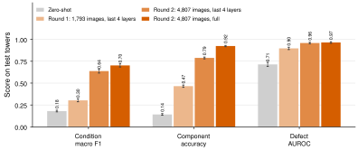
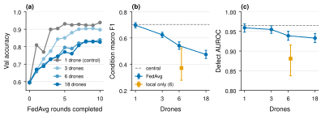
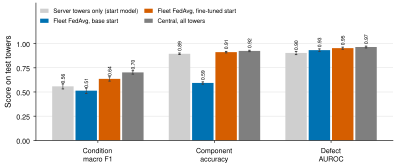
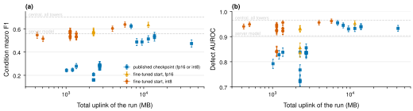
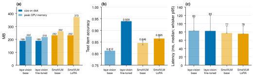

# Route 2: fine-tuning and federated training of the perception model (laya-vision)

Branches: `vision-fl` (zero-shot, fine-tuning, federated rounds A to E) and `vision-quant` (4-bit models). The branch `agentic-ppo-v2` contains all this work.
Read `00_foundations.md` first.

## 1. The idea in simple words

Route 1 trained a small controller and did not change the perception models. Route 2 asks the opposite question: can the fleet improve the **perception model itself**, without sending images to a server?

The model is **laya-vision**, a vision-language **decision model**. It looks at an image and answers typed questions with probabilities, in one forward pass. It does not generate text. The route has three parts:

1. Test the published model without training (zero-shot).
2. Fine-tune it on one server (central training).
3. Train it with FedAvg across simulated drones, and measure the cost in upload.

Mechanical analogy: route 1 trains the inspector who decides which test to use. Route 2 trains the measurement instrument itself. A better instrument helps every decision, but each update of the instrument is large and expensive to send.

## 2. The model: laya-vision

### 2.1 Architecture

| Part | What it does | Size |
|---|---|---|
| Vision encoder (from SmolVLM-256M) | Changes the image into image tokens | part of the backbone |
| Language backbone (SmolVLM-256M, cut to 20 layers) | Reads the image tokens, the question and the options | part of the backbone |
| Decision head (2 transformer layers, width 576, 9 attention heads) | Mixes the features of the options | small |
| Option scorer (layer norm, linear, GELU, linear) | Gives one score (logit) for each option | small |
| Total | | 201M parameters |

The text that the model reads for one question is:

```text
<|im_start|>User:<image>
choice question: Which condition does this power line component have?<end_of_utterance>
Assistant: Options:
- good, no defect
- rust
- corrosion
- missing cap
- bird nest
- other defect (torn part or peeling paint)
```

The model takes the hidden state at the line end of each option. The scorer gives one logit for each option. A softmax with a temperature changes the logits into probabilities. A yes/no question ("noul" type) has two options: "false" and "true".

`docs/understanding/03_agentic_tool_selection.md` has a full example with a real image, the input and the output.

Mechanical analogy: the backbone is a large, general sensor. The decision head is a small signal-conditioning circuit that changes the general sensor output into the specific values that the inspection needs.

### 2.2 The four questions

| Question | Type | Options |
|---|---|---|
| component | choice | 11 component types |
| defect | yes/no | false, true |
| condition | choice | good, rust, corrosion, missing cap, bird nest, other defect |
| judgeable | yes/no | Is the image clear enough? |

All four questions use the same image tokens. Thus four questions cost almost the same time as one question (72 ms against 71 ms on an RTX 2080 Ti).

### 2.3 Preprocessing

- The images come from InsPLAD. They are crops of one component.
- The SmolVLM image processor resizes each image and changes it into image tokens. The project uses the settings of the checkpoint.
- The labels come from the folder names of InsPLAD (for example `rust/`, `missing-cap/`). `src/fedorch/vision.py` maps the folder names to the six conditions and the 17 asset types to 11 component names.

## 3. Is this classification?

Yes. Each question is a classification:

- component and condition: multi-class classification,
- defect and judgeable: binary classification.

The model is one network with four classification outputs that share the image features. This is **multi-task classification**.

## 4. Training method

### 4.1 The loss

The laya library trains with two terms (`laya/vlm_train.py`):

1. A **soft cross-entropy** between the predicted option probabilities and the target.
2. A **proper scoring rule** term. It adds noise to the logits, gives a reward from a proper scoring rule (spherical and ranked probability scores), and uses a policy-gradient update.

A proper scoring rule gives the maximum expected reward only when the model reports its true belief. Thus this term helps the model to give honest probabilities, not only the correct class.

After training, the library fits one **temperature** for each question type on held-out images. This step calibrates the probabilities (`00_foundations.md`, section 7).

### 4.2 What the training changes

| Setting | Trainable part | Parameters |
|---|---|---|
| `last_n` | Decision head and the last 4 language layers | 22.6M |
| `full` | All parameters except the vision encoder | most of the 201M |

Other settings: about 2.5 passes over the data, batch 8, 25 warm-up steps and fp32. The learning rate is $10^{-4}$ for the head and $2 \cdot 10^{-5}$ for the layers.

## 5. Results of the central training

### 5.1 Zero-shot: the published model fails

On the 6,092 test-tower images, the published model has a condition macro F1 of 0.180. "Always good" gives 0.158. It gives "good" for 480 of 601 defect images. Its defect AUROC is 0.714. It does not know the components (accuracy 0.142).

### 5.2 Fine-tuning: two rounds

| Run | Training images | Defect share | Condition macro F1 | Component accuracy | Defect AUROC | Defect ECE |
|---|---|---|---|---|---|---|
| Zero-shot | 0 | — | 0.180 | 0.141 | 0.714 | 0.178 |
| Round 1, `last_n` | 1,793 | 79% | 0.303 | 0.465 | 0.898 | 0.405 |
| Round 2, `last_n` | 4,807 | 44% | 0.637 | 0.789 | 0.959 | 0.094 |
| Round 2, `full` | 4,807 | 44% | **0.703** | **0.924** | **0.965** | **0.058** |



*Figure: test-tower metrics of the fine-tuned laya-vision models.*

Lessons:

1. **The class mix matters.** Round 1 had 79% defects. The model then called many good images defective, and the calibration error became very large (0.405). Round 2 used all defect images plus 300 good images for each component (44% defects). This change gave most of the gain.
2. **More trainable parameters help** with about 5,000 images: `full` is better than `last_n` on every metric.
3. **The fine-tuned model is near the other tools.** Item accuracy: laya-vision 0.948, ResNet-50 0.961, SmolVLM with LoRA 0.956.

## 6. Federated training

### 6.1 How the simulation works

- A drone is a group of towers with its images. The drone never sends images.
- In each round, each drone trains a copy from the global weights and sends the **change of the weights** (the update). The server takes the mean of the updates, weighted by the data size (FedAvg).
- The uplink is the update size times the drones and the rounds. A full update is 229.5 MB in fp16 and 115 MB in int8.
- Each run has one seed. The intervals are 95% bootstrap intervals on the test images.

### 6.2 Round A: more drones with the same data

| Run | Drones | Condition macro F1 | Defect AUROC |
|---|---|---|---|
| Central (reference) | 1 server | 0.703 | 0.965 |
| Control: federated loop with 1 drone | 1 | 0.697 | 0.959 |
| FedAvg | 3 | 0.624 | 0.955 |
| FedAvg | 6 | 0.541 | 0.939 |
| FedAvg | 18 | 0.474 | 0.933 |
| Each drone alone (mean of 6) | 6 | 0.371 | 0.881 |

The control with 1 drone equals the central model. Thus the federated loop has no error. With the same total training, FedAvg becomes worse when the data goes to more drones. But FedAvg is better than drones that train alone.



### 6.3 Two start models

A server can own some towers and fine-tune a **server model** first. Then the fleet (5 drones) continues with FedAvg.

| Start of the fleet | Condition macro F1 | Defect AUROC |
|---|---|---|
| Server model alone (13 server towers) | 0.558 | 0.903 |
| FedAvg from the published model | 0.513 | 0.932 |
| FedAvg from the server model | **0.636** | **0.953** |

The start matters more than any other setting. The fleet improves the server model without sending images.



### 6.4 Rounds B to E: update size, few labels, different data

| Round | Question | Main result |
|---|---|---|
| B | Can a smaller update (head, LoRA, last 4 layers) save upload? | From the published model, small updates learn very little in 10 rounds (macro F1 0.24 to 0.29). int8 equals fp16. FedProx changes nothing. |
| C | What if each drone has only 25 to 200 labels? | Only the fine-tuned start works. With 25 or 50 labels, FedAvg decreases the AUROC (0.903 to 0.856 and 0.836). |
| D | Do drones with different image types hurt FedAvg? | From the published model, the split has no measurable effect, because the small update learns too slowly. |
| E1 | Update size from the server model (int8) | All updates increase the AUROC (0.940 to 0.962). Small updates double the calibration error (0.06 to 0.14 or 0.15). |
| E2 | Few labels from the server model | With 50 labels per drone, the AUROC falls (0.839). Balanced sampling on each drone gives 0.925, with more false alarms. |
| E3 | Different image types from the server model | Each rare defect type keeps at least half of its central recall. Drones alone have a mean macro F1 of 0.481. |

Round E1 in numbers (5 drones, 10 rounds, int8):

| Update | Uplink of the run | Macro F1 | Defect AUROC | ECE |
|---|---|---|---|---|
| Server model (no fleet) | 0 | 0.558 | 0.903 | 0.063 |
| Head only | 425 MB | 0.547 | 0.940 | 0.149 |
| LoRA rank 8 | 505 MB | 0.515 | 0.949 | 0.143 |
| Last 4 layers | 1,130 MB | 0.537 | 0.948 | 0.144 |
| All 20 language layers | 3,965 MB | 0.604 | 0.956 | 0.085 |
| Full model | 5,735 MB | **0.638** | **0.962** | 0.065 |



*Figure: test macro F1 and defect AUROC of all 42 federated configurations against the total uplink of the run.*

**Why the calibration error doubles.** The fleet drones have 34% to 67% defects, but the test towers have 10%. Small updates move the probabilities towards the fleet mix. A Platt fit on 1,500 server images corrects it (ECE 0.024 to 0.027). This is the same label-shift problem as in `00_foundations.md`, section 8.

## 7. Quantisation to 4 bits

The 4-bit models must fit on a small drone computer.

| Model | Size on disk | Item accuracy fp32 | Item accuracy 4-bit | Note |
|---|---|---|---|---|
| laya-vision, fine-tuned | 189 MB | 0.948 | 0.939 | Defect AUROC 0.967, almost no loss |
| SmolVLM-256M with LoRA | 232 MB | 0.956 | 0.865 | Answers "good" for 98% of the items |

4-bit is not faster on the RTX 2080 Ti (82.6 ms against 74.0 ms). A possible cause of the SmolVLM loss: the LoRA changes are small, and the 4-bit rounding of the merged weights removes them. This cause was not tested.



## 8. Design decisions and the route

| Date | Decision | Reason |
|---|---|---|
| 2026-11-05 | Use laya-vision, not a text generator | One forward pass, probabilities for all options, 72 ms |
| 2026-11-05 | Test zero-shot first | To know the start point |
| 2026-11-06 | Round 1 with balanced conditions | The guide of the library |
| 2026-11-07 | Round 2: all defects plus 300 good images for each component | Round 1 had too many defects and bad calibration |
| 2026-11-07 | `full` as the base model | Best on all metrics |
| 2026-11-08 | Same total training for all drone numbers | A fair comparison of the split only |
| 2026-11-08 | Server model as a start | The published model learns too slowly in a federated setting |
| 2026-11-08 | int8 updates | Same result as fp16 at half the uplink |
| 2026-11-09 | 4-bit models | Memory of a drone computer |
| 2026-11-09 | Use the fine-tuned 4-bit laya-vision as a tool in route 3 | It keeps its accuracy in 4-bit |

## 9. Weaknesses and limits

- Each federated run has one seed. Small differences between runs are not reliable.
- The scripts simulate the drones and the network. They calculate the uplink, and they do not measure it.
- The labels come from folder names. Some folders can contain wrong labels.
- The class "other defect" has only 5 test images. Its metrics are not reliable.
- The `judgeable` question was never trained, and its output has no value as a confidence signal.
- The latency comes from desktop GPUs. No Jetson measurement exists.

## 10. What this route gives to the project

The perception model improves with the fleet, but the cost is 0.4 to 41 GB of upload for each training run. The routing controller of route 1 costs about 7 MB. Small perception updates also need a new calibration. This comparison was the core of the paper "Federate the Decision, Not the Model".

## 11. Code and result files

| Item | Path |
|---|---|
| Questions and labels | `src/fedorch/vision.py` |
| Fine-tuning and evaluation | `scripts/vision_finetune.py`, `scripts/vision_run.py`, `scripts/vision_summarize.py` |
| Federated training | `src/fedorch/federated.py`, `scripts/vision_fl.py`, `scripts/runs/fl_*.sh` |
| Results | `results/vision/*/summary.json` |
| Result documents | `docs/vision_results.md`, `docs/vision_finetune_results.md`, `docs/vision_finetune_round2_results.md`, `docs/vision_fl_results.md`, `docs/vision_fl_bcd_results.md`, `docs/vision_fl_round_e_results.md`, `docs/quant_results.md` |
