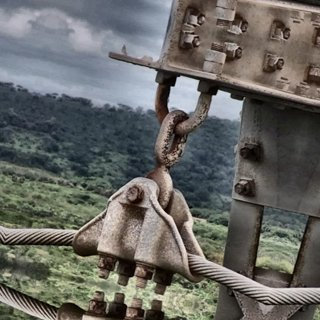
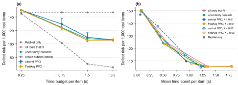
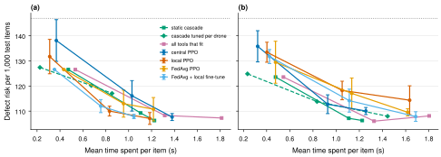
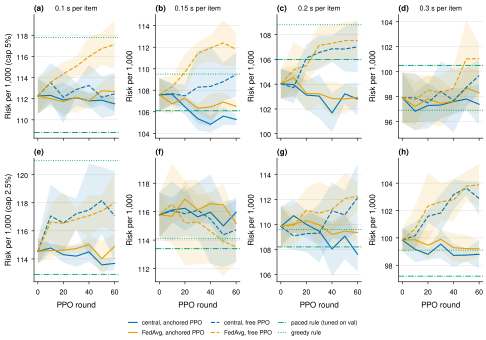

# Route 3: agentic tool selection with deep reinforcement learning

Branch: `agentic-ppo-v2`. Read `00_foundations.md` first. The detailed results are in `docs/tool_selection_results.md`.

## 1. The idea in simple words

Route 1 used one decision for each frame: accept, or send to one other tool. Route 3 lets the drone **call several tools one after the other**, within a time budget, and stop when it is sure enough. The drone can also **defer**: send the image to a human operator.

The route tested two designs:

1. **Agentic design**: a vision-language model (laya-vision) is the agent. It looks at the image, decides to zoom or to ask another model, reads the answers as text, and writes the report.
2. **Routing design**: a small policy network only decides which tool to call next. The report comes from a combination of the tools' own answers.

Both designs train with PPO, central and with FedAvg across drones.

Mechanical analogy: think of an inspection engineer with several instruments: a quick visual check, an ultrasonic probe, an X-ray in a remote laboratory. The engineer has 3 minutes for each part. After each measurement, the engineer decides: measure again with another instrument, sign the report, or ask a senior engineer. Route 3 tries to learn this decision policy.

## 2. The tools

| Tool | Model | Runs on | Time for each image | Risk alone |
|---|---|---|---|---|
| ResNet | ResNet-50, fine-tuned | drone | 0.07 s | 177 |
| laya | laya-vision (201M), fine-tuned (route 2) | drone | 0.70 s | 261 |
| SmolVLM | SmolVLM-256M with LoRA | drone | 0.73 s | 185 |
| Qwen | Qwen3-VL-8B, zero-shot | cloud | 0.18 s plus the upload | 626 |

ResNet always runs first. The drone times are desktop GPU times multiplied by 9. A Qwen call also needs the upload of a JPEG (median 33 kB) over the weak LTE network. This network has about 3 Mbit/s and six 20 s outages per hour. "Risk alone" is the risk per 1,000 test items when only this tool answers.

## 3. Part A: a VLM as the agent (it does not work)

### 3.1 How it works

The agent is laya-vision. Its actions are options of a typed question: zoom into one of five crops, ask ResNet, ask Qwen, or report. When a tool answers, the answer goes into the next question as text. PPO trains the part of laya that scores the options. The training uses saved backbone outputs of 800 images, and the test uses 400 images, with budgets of 1, 3 and 6 s.

### 3.2 A real input and output of laya-vision

Image: a test-tower image of a rusty lightning-rod suspension.



Input to `agent.predict` (four questions, `src/fedorch/vision.py`):

```python
{"image": "<InsPLAD>/supervised_fault_classification/defect_supervised/lightning-rod-suspension/train/rust/09-06-2021_DJI_0299_526_3.jpg"}
{"component": {"type": "choice", "instructions": "Which power line component is in this image?",
               "criteria": ["stockbridge damper", "preformed damper", "glass insulator", "polymer insulator", "shackle",
                            "lightning rod suspension", "vari-grip clamp", "yoke", "yoke suspension", "spacer", "plate"]},
 "defect":    {"type": "noul", "instructions": "Does this power line component have a defect?"},
 "condition": {"type": "choice", "instructions": "Which condition does this power line component have?",
               "criteria": ["good, no defect", "rust", "corrosion", "missing cap", "bird nest",
                            "other defect (torn part or peeling paint)"]},
 "judgeable": {"type": "noul", "instructions": "Is the image clear enough to judge the condition of the component?"}}
```

Output of the fine-tuned model (saved in `results/vision/good300_full/predictions.jsonl`):

```json
{"component": {"lightning rod suspension": 0.9598, "shackle": 0.0069, "...": "9 more options below 0.006"},
 "defect": 0.9641,
 "condition": {"rust": 0.9846, "good, no defect": 0.0042, "...": "4 more options below 0.004"},
 "judgeable": 0.6471}
```

### 3.3 Results

| What PPO trains | Report cost without tools | Report cost with tools |
|---|---|---|
| Scorer, central | 1,505 | 1,715 |
| Scorer, FedAvg | 1,505 | 1,628 |
| Decision head (8.65M weights), central | 1,438 | 1,570 |
| Decision head, FedAvg | 1,438 | 1,725 |

The report cost adds the defect risk and the errors on component and condition. In every case, **the report with tools is worse than the report without tools**. A fine-tuned laya also learned to call no tool: each tool changed more correct answers into wrong answers than the opposite.

**Zoom check.** Zoom also does not help the classifier. The full image gives a test risk of 110, and the best zoom rule 127. The defects that ResNet misses are in small source crops (median 62,000 pixels against 110,000 for the defects it finds). Thus zoom gives no new detail.

**Design decision**: stop the agentic design. Use the tools' own answers.

## 4. Part B: combine the answers (fusion)

### 4.1 The model

Each tool gives a defect probability $p_k$. A **logistic regression** combines them:

$$p_C = \sigma\left(w^\top x_C\right), \qquad x_C = \left[\mathrm{logit}\,p_{\text{ResNet}},\ \mathrm{logit}\,p_k \text{ for } k \in C,\ \text{task},\ \text{component}\right]$$

$C$ is the set of tools that the drone called. A missing tool enters as 0 with a flag, so one model can score every set of tools. A later version fits one model for each set. The fusion trains on the validation towers. The project selects the regularisation by 5-fold cross-validation by tower.

This is a **binary classification**: defect or not.

### 4.2 The threshold without labels

The test towers have fewer defects (15.1%) than the validation towers (19.6%). A threshold tuned on validation is thus too low and gives many false alarms. The EM correction (`00_foundations.md`, section 8) estimates the test share without labels: 15.4% (true 15.1%). Then the Bayes threshold 1/11 applies.

| Method | Risk per 1,000 test items |
|---|---|
| Best single tool (ResNet) | 177 |
| Fusion, threshold tuned on validation | 116 |
| Fusion, threshold 1/11 | 114 |
| Fusion, threshold 1/11 after EM correction | **107** |
| Fusion, best threshold (uses test labels) | 105 |

This is the **largest single gain** of the route. It needs no reinforcement learning.

## 5. Part C: learn which tool to call (PPO)

### 5.1 The decision problem for one image

| Element | Value |
|---|---|
| State | 39 numbers: the fused probability, its distance to the threshold, and the expected risk of a report now. Also the ResNet score, the scores of the called tools, and the time left. Also the bandwidth, the link state, the time of each tool, image statistics and the component. |
| Actions | report, call laya, call SmolVLM, call Qwen, defer |
| Mask | A tool is possible only if it was not called and fits in the remaining time. Qwen is not possible during an outage. |
| Reward | At the end: $R = -\,r(a, y) - \lambda\,\tau/B$, with the risk $r$ from `00_foundations.md`, the time used $\tau$ and the budget $B$ |
| Episode | One image |

The time of a Qwen call depends on the bandwidth $b$ at that moment:

$$c_{\text{Qwen}} = t_{\text{compute}} + t_{\text{round trip}} + \frac{8 \times \text{bytes}}{10^6\, b}$$

### 5.2 The policy and the training

| Part | Value |
|---|---|
| Policy | MLP, two hidden layers of 64 units, tanh, about 7,000 weights (28 KB) |
| Critic | MLP, one hidden layer of 64 units |
| Algorithm | PPO, clip 0.2, entropy weight 0.01, 4 epochs for each batch, Adam |
| Advantage | Return minus the critic value (one image). GAE with $\gamma = 0.98$ and $\lambda = 0.9$ (segments) |
| Training data | Validation towers, with out-of-fold fusion |
| Test data | Test towers, with the fusion fitted on all validation towers |
| FedAvg | 5 drones with different tower groups. One PPO update for each drone and round, then the weighted mean |

### 5.3 Results without deferral



*Figure: (a) risk at each time budget. (b) risk against the time spent. PPO: mean of 3 seeds.*

At 3 s, PPO reaches the risk of "call all tools" (106 against 105) with 30% less time (1.26 s against 1.81 s). FedAvg is equal to central training. But a simple **uncertainty cascade** gives the same result: call the next tool while the fused probability is near the threshold.

**Why the label oracle is not a target.** An oracle knows the label and picks the best set of tools for each item. It gets 65. It is better than full fusion on only 127 of 7,057 items. 83% of these items are within 0.1 of the threshold. The tool sets disagree there, and only the label shows the correct side. No method without labels can do this.

### 5.4 Results with deferral

| Method | Risk at 0.75 s | Risk at 3 s | Time at 3 s | Deferred |
|---|---|---|---|---|
| Uncertainty cascade, no deferral | 112 | 105 | 1.22 s | 0% |
| Cascade with defer | 99 | 94 | 0.25 s | 7% |
| All tools, then defer if uncertain | **96** | **92** | 1.81 s | 11% |
| PPO, 2,048 episodes per round | 115 | 106 | 1.27 s | 0% |
| PPO, 8,192 episodes per round | 106 | 95 | 0.37 s | 8% |

Deferral is the **second large gain** (11 to 15 points). PPO with small batches never learns to defer. Deferral costs 0.5 on easy images, where a report costs almost nothing. Thus PPO stops the action before it learns to use it only on uncertain images. With 4 times larger batches, PPO learns it, but it only matches the rules.

### 5.5 Drones that differ

Each of 5 drones got one component group and its own network quality (poor, good, weak, poor, good). The conclusion did not change. FedAvg followed by a short local training was the most stable learned method (108 against 106 for the cascade, with 15% less time). Rules tuned for each drone separately were worse (117), because the validation and test towers of a drone differ.



## 6. Part D: mission segments (a constrained problem)

### 6.1 Why

With a separate budget for each image, each decision stands alone. Then a threshold on the probability is almost optimal, and a rule is enough. In a mission, the images **share** the time and the attention of the operator. A good policy must save time on easy images and spend it on hard images.

### 6.2 The constrained MDP

One episode is $N = 40$ images of one tower, in order. The constraints are:

$$\sum_{n=1}^{N} \tau_n \le N\beta, \qquad \sum_{n=1}^{N} \mathbb{1}[a_n = \text{defer}] \le \lfloor \delta N \rfloor$$

$\beta$ is the time for each image (0.1 to 0.3 s). $\delta$ is the share of images that the drone may defer (5% or 2.5%). The action mask enforces both constraints. The mask keeps the ResNet time for all remaining images. The network follows the trace in mission time, so an outage lasts over several images. The state gets 9 more numbers. They include the images left, the time left and the deferrals left. They also include the time since the link changed and the uncertainty of the last five images.

Mechanical analogy: this is a scheduling problem with a shared resource, like the time of one test machine for a batch of 40 parts. The constraint is hard, like a machine that stops at the end of the shift.

### 6.3 The rules

- **Greedy cascade with defer**: spends time and deferrals as the images come.
- **Paced cascade**: gives each remaining image an equal part of the remaining time. It defers only above a risk threshold. The project tunes the pace and the threshold on the validation towers.

### 6.4 The PPO variants

| Variant | Training |
|---|---|
| From scratch | PPO with GAE, 30 rounds of 256 segments |
| Warm start | First copy the paced cascade (imitation, cross-entropy to its actions on 2,000 segments), then 60 PPO rounds with learning rate $10^{-4}$ |
| Anchored | Warm start, plus a loss term $\alpha \log \pi(a_{\text{rule}} \mid s)$ with $\alpha = 0.5$ that keeps the policy near the rule |

### 6.5 Results (risk per 1,000 test items, mean of 5 seeds)

| Method | 5%, 0.1 s | 5%, 0.2 s | 5%, 0.3 s | 2.5%, 0.1 s | 2.5%, 0.2 s | 2.5%, 0.3 s |
|---|---|---|---|---|---|---|
| Greedy cascade | 117.8 | 108.8 | **96.9** | 121.0 | 109.6 | 99.1 |
| Paced cascade | **108.8** | 106.0 | 100.5 | **112.9** | 108.2 | **97.2** |
| PPO from scratch | 122.8 | 120.7 | 114.8 | 122.1 | 121.4 | 115.4 |
| Copy of the paced cascade | 112.3 | 104.0 | 97.9 | 114.5 | 109.8 | 99.8 |
| Warm start, free PPO | 112.5 | 107.0 | 99.7 | 117.1 | 112.1 | 102.9 |
| Anchored PPO, central | 111.5 | **102.8** | 97.4 | 113.7 | **107.6** | 98.8 |
| Anchored PPO, FedAvg | 112.7 | 102.9 | 98.3 | 114.9 | 109.3 | 99.2 |



*Figure: risk during the PPO training. Round 0 is the copy of the rule. Solid: anchored PPO. Dashed: free PPO.*

Lessons:

1. **Planning matters.** At 0.1 s per image, the paced cascade is 8 to 9 points better than the greedy one.
2. **PPO from scratch fails.** It is 10 to 25 points worse everywhere. It uses all its time and deferrals, but on the wrong images.
3. **The copy works, PPO hardly improves it.** The copy agrees with the rule on 98% of the actions. Free PPO makes it worse in 14 of 16 settings. Anchored PPO changes it by at most 2 points and beats the best rule clearly only in one setting (5%, 0.2 s: 102.8 against 106.0).
4. **FedAvg equals central training** in all settings, with updates of about 30 KB.

## 7. Latency against published measurements

| System | Time | Upload |
|---|---|---|
| SmolVLM-256 on a Jetson Orin, per image (Farahani et al., From Pixels to Semantics) | 2.8 s | — |
| EVLM (SmolVLM), per 4 s segment (Farahani et al.) | 1.4 to 6.4 s | 25 kB |
| This work: cascade with defer, per image | 0.25 s | 3.4 kB |
| This work: paced cascade or anchored PPO in segments, per image | 0.18 s | 1.6 kB |

The units are different: an EVLM segment contains several frames and a text report. Our onboard SmolVLM time (0.73 s with the factor 9) is 3.7 times shorter than the Jetson measurement. If the true times are longer, selective calls and deferral become even more important.

## 8. Design decisions and the route

| Step | Decision | Reason |
|---|---|---|
| 1 | Federated PPO with Flower (FedAvg, FedProx, FedAvgM, FedAdam) | The user asked for a standard framework |
| 2 | 4-bit fine-tuned laya-vision and 4-bit SmolVLM with LoRA as tools | Drone memory |
| 3 | Laya questions in the same format as the fine-tuning | The model works best with its training format |
| 4 | Budgets up to 60 s and a larger Qwen answer length | The user asked for more room for tools |
| 5 | A quick test with about 1,000 images | Test the idea before a large run |
| 6 | Baseline: laya only | Simple reference |
| 7 | Base laya as the agent, tools zoom, ResNet and Qwen | User choice after the first test |
| 8 | Separate scorers, then PPO on the decision head | The shared scorer coupled the action and the report |
| 9 | Stop the agentic design | Tools made the report worse in all six configurations |
| 10 | Fusion of the tools' own answers with the EM threshold | The gap analysis showed a threshold problem |
| 11 | Zoom check | The misses were rust on small lower shackles |
| 12 | PPO for tool selection on top of the fusion | The user's focus |
| 13 | Time weight $\lambda$ = 0.01 and 0.03 | With 0.2, PPO correctly learned to call no tool |
| 14 | Drones with different components and networks | A rule must fail when drones differ |
| 15 | The DEFER action | The oracle gain is at the threshold, where deferral pays |
| 16 | Mission segments with shared constraints | A per-image budget makes every decision independent |
| 17 | GAE and memory features | Monte-Carlo returns over 40 images were too noisy |
| 18 | Warm start from the rule, with an anchor | Standard practice when RL from scratch fails |

## 9. Weaknesses and limits

- The replay uses saved tool answers. It simulates the network and the Jetson times, and the factor 9 is an estimate.
- The risk weights 10, 1 and 0.5 are assumptions. A higher deferral cost decreases the gain of deferral.
- The deferral in the per-image test has no cap. The operator capacity is an assumption.
- We chose the anchored variant after we saw the test results. Thus its one gain is optimistic.
- The agent experiments use one seed. The tool-selection experiments use 3 to 5 seeds.
- The report in the PPO environment covers only the defect decision, not the component and condition.
- FedAvg for tool selection runs in one process. It is the same update as Flower FedAvg, but it does not test the communication.

## 10. What this route gives to the project

The largest gains came from classical steps: fusion of the tools' answers, the EM threshold, and deferral. Deep reinforcement learning learned correct, budget-aware policies, central and federated with small updates. It matched well-tuned rules, but it did not reliably beat them. The paper `paper_2col.tex` reports this result.

## 11. Code and result files

| Item | Path |
|---|---|
| VLM agent experiments | `scripts/agent_cache.py`, `src/fedorch/laya_agent.py`, `scripts/agent_ppo.py`, `scripts/agent_ppo_head.py`, `results/agent_ppo*/` |
| Fusion | `scripts/fusion_check.py`, `results/fusion/` |
| Zoom check | `scripts/zoom_check.py`, `scripts/zoom_analyze.py`, `results/zoom/` |
| Environment for one image | `src/fedorch/route_env.py`, `scripts/route_ppo.py`, `results/route/summary_*.json` |
| Drones that differ | `scripts/route_drones.py`, `results/route/drones_*.json` |
| Mission segments | `src/fedorch/mission_env.py`, `scripts/route_mission.py`, `results/route/mission*.json`, `results/route/mission_warm/` |
| VM run script | `scripts/runs/mission_warm.sh` |
| Figures | `figs/route_figures.py`, `figs/mission_figure.py` |
